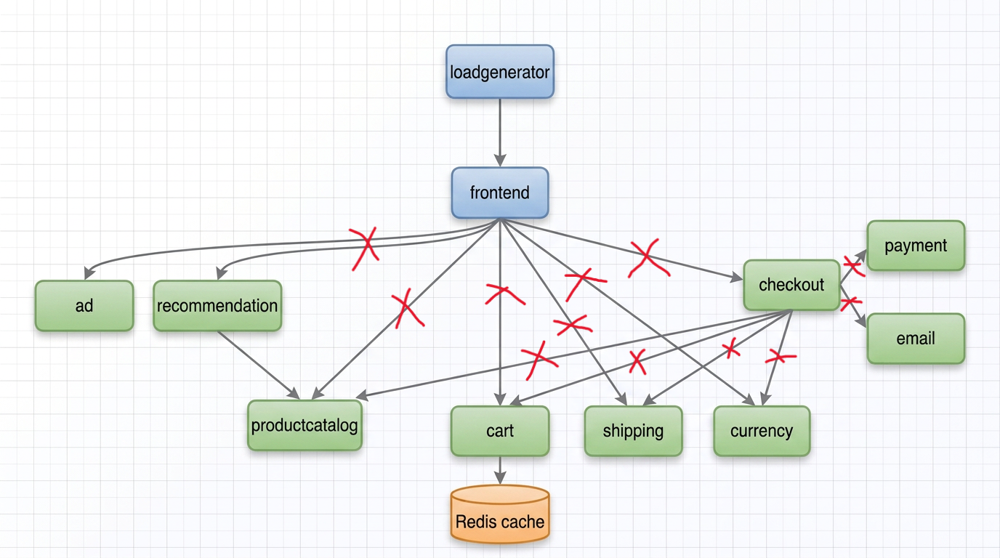
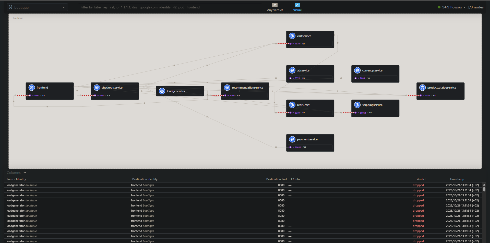
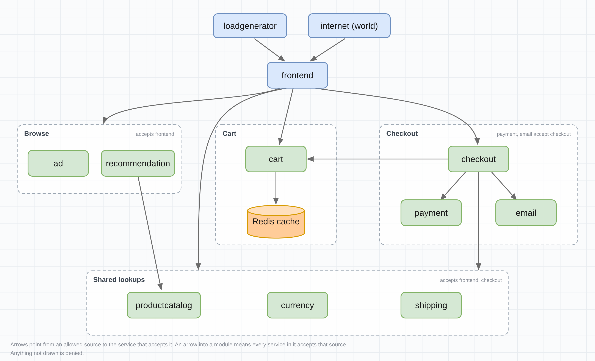
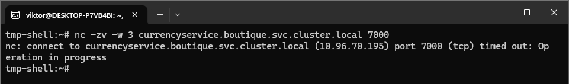
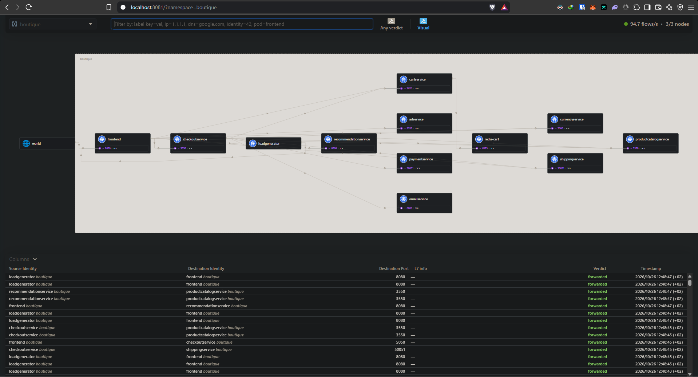

# Cilium Zero Trust Deployment
By default kubernetes allows all pods to comunicate with each other to the outside world. This is convenient but exposes a potential fault as a compromisied workload can reach databases, internal APIs and external services with nothing in is way. Cilium can be used to prevent this by adding a layer of security between workloads and the outside world.

## Initial setup
This project deploys [Google's Online Boutique microservice](https://github.com/GoogleCloudPlatform/microservices-demo) and uses Cilium to secure the communication between the services. Cilium is deployed on a 3-node Kind cluster with L2 announcement and observability enabled through hubble. You can find the deployemnt here [cilium-values](./cilium-values.yaml).

The microservice is deployed into the `boutique` namespace. It's architecture is as follows:
[](./assets/architecture-diagram.png)

It's hubble dashboard at this stage closely mirrors the architecture diagram.

[](./assets/Initial%20screen.png)

## Securing Communication
From the architecture we can develop a call graph of what pods should be able to communicate with each other. 

[](./assets/boutique-egress-modules.png)

But currently each pod can communicate freely with any other pod, even pods they have no business with. For instance by sshing into the payment pod we can access the ad service:

[](./assets/free-communication.png)

```log
Oct 28 14:40:15.276: boutique/paymentservice-78f6cfdf7f-jx25l:40287 (ID:63978) -> boutique/adservice-6bfc5fc46c-vqw8z:9555 (ID:60129) to-endpoint FORWARDED (TCP Flags: SYN)
Oct 28 14:40:15.276: boutique/paymentservice-78f6cfdf7f-jx25l:40287 (ID:63978) -> boutique/adservice-6bfc5fc46c-vqw8z:9555 (ID:60129) to-endpoint FORWARDED (TCP Flags: ACK)
Oct 28 14:40:15.276: boutique/paymentservice-78f6cfdf7f-jx25l:40287 (ID:63978) -> boutique/adservice-6bfc5fc46c-vqw8z:9555 (ID:60129) to-endpoint FORWARDED (TCP Flags: ACK, FIN)
Oct 28 14:40:15.757: boutique/paymentservice-78f6cfdf7f-jx25l:40287 (ID:63978) -> boutique/adservice-6bfc5fc46c-vqw8z:9555 (ID:60129) to-endpoint FORWARDED (TCP Flags: RST)
```

As we can see from the logs request from the payment service is successfully forwarded to the ad service.

### Denying communication
We set up a cluster wide policy to deny egress from all pods not within the `kube-system` namespace. It is important to note that the pods still have DNS access. The policy is defined in the [deny-egress.yaml](./default-deny.yaml) file.
The architecture now looks like this: 

[](./assets/deny-egress.png)

```log
Oct 28 14:56:45.927: boutique/paymentservice-78f6cfdf7f-jx25l:40909 (ID:63978) <> boutique/adservice-6bfc5fc46c-vqw8z:9555 (ID:60129) policy-verdict:none TRAFFIC_DIRECTION_UNKNOWN DENIED (TCP Flags: SYN)
Oct 28 14:56:45.927: boutique/paymentservice-78f6cfdf7f-jx25l:40909 (ID:63978) <> boutique/adservice-6bfc5fc46c-vqw8z:9555 (ID:60129) Policy denied DROPPED (TCP Flags: SYN)
Oct 28 14:56:46.942: boutique/paymentservice-78f6cfdf7f-jx25l:40909 (ID:63978) <> boutique/adservice-6bfc5fc46c-vqw8z:9555 (ID:60129) policy-verdict:none TRAFFIC_DIRECTION_UNKNOWN DENIED (TCP Flags: SYN)
Oct 28 14:56:46.942: boutique/paymentservice-78f6cfdf7f-jx25l:40909 (ID:63978) <> boutique/adservice-6bfc5fc46c-vqw8z:9555 (ID:60129) Policy denied DROPPED (TCP Flags: SYN)
Oct 28 14:56:47.966: boutique/paymentservice-78f6cfdf7f-jx25l:40909 (ID:63978) <> boutique/adservice-6bfc5fc46c-vqw8z:9555 (ID:60129) policy-verdict:none TRAFFIC_DIRECTION_UNKNOWN DENIED (TCP Flags: SYN)
Oct 28 14:56:47.966: boutique/paymentservice-78f6cfdf7f-jx25l:40909 (ID:63978) <> boutique/adservice-6bfc5fc46c-vqw8z:9555 (ID:60129) Policy denied DROPPED (TCP Flags: SYN)
```

We can see a fuller vision of the communication state through hubble.

[](./assets/deny-egress-hubble.png)

We can now deploy the egress rules in according to the aforementioned call graph. This can be done using the [egress-network-policies.yaml](./egress-network-policies.yaml) file.

We can test the communication by calling the payment and email service from checkout. We can see the requests are approved by the policy.
```logs
Oct 28 15:55:38.369: boutique/checkoutservice-5d5f4589c5-pvh48:36306 (ID:40344) -> boutique/emailservice-558899d44c-lw6j7:8080 (ID:14088) to-endpoint FORWARDED (TCP Flags: ACK)
Oct 28 15:55:51.475: boutique/checkoutservice-5d5f4589c5-pvh48:36306 (ID:40344) -> boutique/emailservice-558899d44c-lw6j7:8080 (ID:14088) to-endpoint FORWARDED (TCP Flags: ACK)
Oct 28 15:56:00.182: boutique/checkoutservice-5d5f4589c5-pvh48:36306 (ID:40344) -> boutique/emailservice-558899d44c-lw6j7:8080 (ID:14088) to-endpoint FORWARDED (TCP Flags: ACK, PSH)
Oct 28 15:56:23.897: boutique/checkoutservice-5d5f4589c5-pvh48:36306 (ID:40344) -> boutique/emailservice-558899d44c-lw6j7:8080 (ID:14088) to-endpoint FORWARDED (TCP Flags: ACK, PSH)
Oct 28 15:56:30.131: boutique/checkoutservice-5d5f4589c5-pvh48:36306 (ID:40344) -> boutique/emailservice-558899d44c-lw6j7:8080 (ID:14088) to-endpoint FORWARDED (TCP Flags: ACK, PSH)
Oct 28 15:56:48.966: boutique/checkoutservice-5d5f4589c5-pvh48:36306 (ID:40344) -> boutique/emailservice-558899d44c-lw6j7:8080 (ID:14088) to-endpoint FORWARDED (TCP Flags: ACK, PSH)
----
Oct 28 15:54:54.474: boutique/checkoutservice-5d5f4589c5-pvh48:58206 (ID:40344) -> boutique/paymentservice-78f6cfdf7f-jx25l:50051 (ID:63978) to-endpoint FORWARDED (TCP Flags: ACK, PSH)
Oct 28 15:55:28.244: boutique/checkoutservice-5d5f4589c5-pvh48:58206 (ID:40344) -> boutique/paymentservice-78f6cfdf7f-jx25l:50051 (ID:63978) to-endpoint FORWARDED (TCP Flags: ACK, PSH)
Oct 28 15:55:39.387: boutique/checkoutservice-5d5f4589c5-pvh48:58206 (ID:40344) -> boutique/paymentservice-78f6cfdf7f-jx25l:50051 (ID:63978) to-overlay FORWARDED (TCP Flags: ACK, PSH)
Oct 28 15:55:39.387: boutique/checkoutservice-5d5f4589c5-pvh48:58206 (ID:40344) -> boutique/paymentservice-78f6cfdf7f-jx25l:50051 (ID:63978) to-endpoint FORWARDED (TCP Flags: ACK, PSH)
Oct 28 15:56:00.180: boutique/checkoutservice-5d5f4589c5-pvh48:58206 (ID:40344) -> boutique/paymentservice-78f6cfdf7f-jx25l:50051 (ID:63978) to-overlay FORWARDED (TCP Flags: ACK, PSH)
Oct 28 15:56:00.180: boutique/checkoutservice-5d5f4589c5-pvh48:58206 (ID:40344) -> boutique/paymentservice-78f6cfdf7f-jx25l:50051 (ID:63978) to-endpoint FORWARDED (TCP Flags: ACK, PSH)
Oct 28 15:56:23.895: boutique/checkoutservice-5d5f4589c5-pvh48:58206 (ID:40344) -> boutique/paymentservice-78f6cfdf7f-jx25l:50051 (ID:63978) to-overlay FORWARDED (TCP Flags: ACK, PSH)
Oct 28 15:56:23.895: boutique/checkoutservice-5d5f4589c5-pvh48:58206 (ID:40344) -> boutique/paymentservice-78f6cfdf7f-jx25l:50051 (ID:63978) to-endpoint FORWARDED (TCP Flags: ACK, PSH)
Oct 28 15:56:30.129: boutique/checkoutservice-5d5f4589c5-pvh48:58206 (ID:40344) -> boutique/paymentservice-78f6cfdf7f-jx25l:50051 (ID:63978) to-overlay FORWARDED (TCP Flags: ACK, PSH)
Oct 28 15:56:30.129: boutique/checkoutservice-5d5f4589c5-pvh48:58206 (ID:40344) -> boutique/paymentservice-78f6cfdf7f-jx25l:50051 (ID:63978) to-endpoint FORWARDED (TCP Flags: ACK, PSH)
```

Now we have a more secure architecture. But something is missing, inbound to the pods are still open to communication from other sources. If one pod is compromised and has any egress allow, it can probe other services freely. We test this by deploying a netshoot pod in the `kube-system` namespace:

```sh
kubectl run -n kube-system --rm -it tmp-shell 
\ --image nicolaka/netshoot -- bash
```

The we connect to the cart and redis-cart service:
[](./assets/ingress%20still%20works.png)

```logs
Oct 28 16:19:22.263: kube-system/tmp-shell:41344 (ID:2195) -> boutique/redis-cart-788fbddc7-v54ln:6379 (ID:4056) to-overlay FORWARDED (TCP Flags: SYN)
Oct 28 16:19:22.263: kube-system/tmp-shell:41344 (ID:2195) -> boutique/redis-cart-788fbddc7-v54ln:6379 (ID:4056) to-endpoint FORWARDED (TCP Flags: SYN)
Oct 28 16:19:22.263: kube-system/tmp-shell:41344 (ID:2195) -> boutique/redis-cart-788fbddc7-v54ln:6379 (ID:4056) to-overlay FORWARDED (TCP Flags: ACK)
Oct 28 16:19:22.263: kube-system/tmp-shell:41344 (ID:2195) -> boutique/redis-cart-788fbddc7-v54ln:6379 (ID:4056) to-endpoint FORWARDED (TCP Flags: ACK)
Oct 28 16:19:22.263: kube-system/tmp-shell:41344 (ID:2195) -> boutique/redis-cart-788fbddc7-v54ln:6379 (ID:4056) to-overlay FORWARDED (TCP Flags: ACK, PSH)
Oct 28 16:19:22.263: kube-system/tmp-shell:41344 (ID:2195) -> boutique/redis-cart-788fbddc7-v54ln:6379 (ID:4056) to-endpoint FORWARDED (TCP Flags: ACK, PSH)
Oct 28 16:19:22.264: kube-system/tmp-shell:41344 (ID:2195) -> boutique/redis-cart-788fbddc7-v54ln:6379 (ID:4056) to-overlay FORWARDED (TCP Flags: ACK, FIN)
Oct 28 16:19:22.264: kube-system/tmp-shell:41344 (ID:2195) -> boutique/redis-cart-788fbddc7-v54ln:6379 (ID:4056) to-endpoint FORWARDED (TCP Flags: ACK, FIN)
Oct 28 16:19:22.264: kube-system/tmp-shell:41344 (ID:2195) -> boutique/redis-cart-788fbddc7-v54ln:6379 (ID:4056) to-endpoint FORWARDED (TCP Flags: ACK)
Oct 28 16:19:22.264: kube-system/tmp-shell:41344 (ID:2195) -> boutique/redis-cart-788fbddc7-v54ln:6379 (ID:4056) to-overlay FORWARDED (TCP Flags: ACK)

----

Oct 28 16:19:17.658: kube-system/tmp-shell:60344 (ID:2195) -> boutique/cartservice-896c89968-th2sc:7070 (ID:16800) to-endpoint FORWARDED (TCP Flags: SYN)
Oct 28 16:19:17.658: kube-system/tmp-shell:60344 (ID:2195) -> boutique/cartservice-896c89968-th2sc:7070 (ID:16800) to-endpoint FORWARDED (TCP Flags: ACK)
Oct 28 16:19:17.658: kube-system/tmp-shell:60344 (ID:2195) -> boutique/cartservice-896c89968-th2sc:7070 (ID:16800) to-endpoint FORWARDED (TCP Flags: ACK, FIN)
Oct 28 16:19:17.664: kube-system/tmp-shell:60344 (ID:2195) -> boutique/cartservice-896c89968-th2sc:7070 (ID:16800) to-endpoint FORWARDED (TCP Flags: ACK)
```

To correct this we develop an ingress call graph. To guide in the development of the ingress network policy:

[](./assets/boutique-ingress-modules.png)

We can use our netshoot pod again to test our ingress policy:
[](./assets/after-ingress.png).


## Conclusion

We have created a secure architecture for our boutique application. Looking at the hubble dashboard we can see that the dashboard is a mirror of the intial dashboard. But we know its more secure now 😉.

[](./assets/finished.png)

The app is a lot more locked down now, but there’s still more we can do. Every rule here works at L3/L4, which means it decides who can talk to whom and on which port, but not what they actually say once they’re connected. Cilium’s L7 policies would let us go a step further and limit each service to the exact API calls it needs. For example, we could make sure only checkoutservice can call PaymentService/Charge.