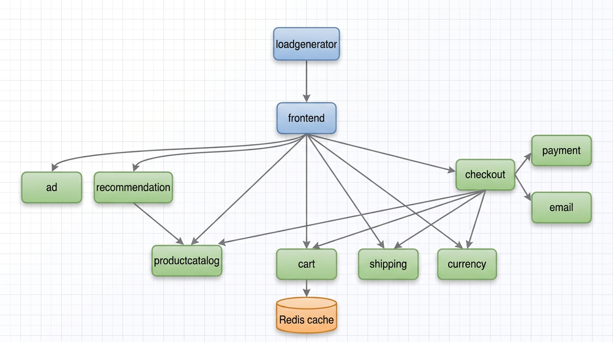
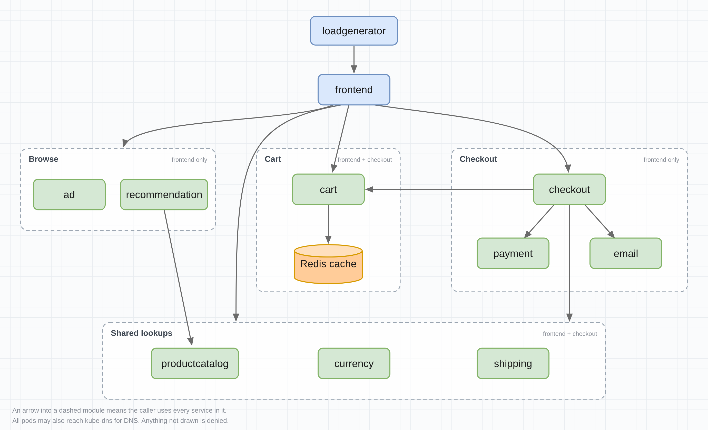
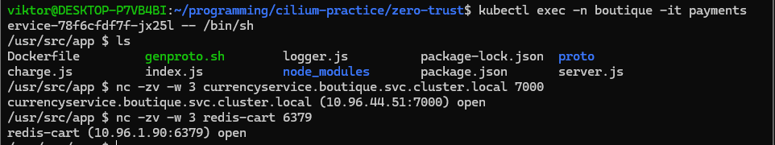

# Cilium Zero Trust Deployment
By default kubernetes allows all pods to comunicate with each other to the outside world. This is convenient but exposes a potential fault as a compromisied workload can reach databases, internal APIs and external services with nothing in is way. Cilium can be used to prevent this by adding a layer of security between workloads and the outside world.

## Initial setup
This project deploys [Google's Online Boutique microservice](https://github.com/GoogleCloudPlatform/microservices-demo) and uses Cilium to secure the communication between the services. Cilium is deployed on a 3-node Kind cluster with L2 announcement and observability enabled through hubble. You can find the deployemnt here [cilium-values](./cilium-values.yaml).

The microservice is deployed into the `boutique` namespace. It's architecture is as follows:
[](./assets/architecture-diagram.png)

It's hubble dashboard at this stage closely mirrors the architecture diagram.

[](./assets/Initial%20screen.png)

## Securing Communication
From the architecture we can develop a call graph of what pods should be able to communicate with each other. 

[](./assets/boutique-egress-modules.png)

But currently each pod can communicate freely with any other pod, even pods they have no business with. For instance by sshing into the payment pod we can access the redis cache:

[](./assets/free-communication.png)

```log
Oct 28 14:13:13.797: boutique/paymentservice-78f6cfdf7f-jx25l:41736 (ID:63978) -> kube-system/coredns-589f44dc88-c9zcj:53 (ID:8570) to-endpoint FORWARDED (UDP)
Oct 28 14:13:13.799: boutique/paymentservice-78f6cfdf7f-jx25l:41736 (ID:63978) <- kube-system/coredns-589f44dc88-c9zcj:53 (ID:8570) to-overlay FORWARDED (UDP)
Oct 28 14:18:59.774: boutique/paymentservice-78f6cfdf7f-jx25l:50207 (ID:63978) -> kube-system/coredns-589f44dc88-c9zcj:53 (ID:8570) to-endpoint FORWARDED (UDP)
Oct 28 14:18:59.775: boutique/paymentservice-78f6cfdf7f-jx25l:50207 (ID:63978) <- kube-system/coredns-589f44dc88-c9zcj:53 (ID:8570) to-overlay FORWARDED (UDP)
Oct 28 14:19:29.894: boutique/paymentservice-78f6cfdf7f-jx25l:59719 (ID:63978) -> kube-system/coredns-589f44dc88-c9zcj:53 (ID:8570) to-endpoint FORWARDED (UDP)
Oct 28 14:19:29.895: boutique/paymentservice-78f6cfdf7f-jx25l:59719 (ID:63978) <- kube-system/coredns-589f44dc88-c9zcj:53 (ID:8570) to-overlay FORWARDED (UDP)
Oct 28 14:23:53.009: boutique/checkoutservice-5d5f4589c5-pvh48:58206 (ID:40344) -> boutique/paymentservice-78f6cfdf7f-jx25l:50051 (ID:63978) to-overlay FORWARDED (TCP Flags: ACK, PSH)
Oct 28 14:23:53.010: boutique/checkoutservice-5d5f4589c5-pvh48:58206 (ID:40344) <- boutique/paymentservice-78f6cfdf7f-jx25l:50051 (ID:63978) to-endpoint FORWARDED (TCP Flags: ACK, PSH)
Oct 28 14:24:03.326: boutique/checkoutservice-5d5f4589c5-pvh48:58206 (ID:40344) -> boutique/paymentservice-78f6cfdf7f-jx25l:50051 (ID:63978) to-overlay FORWARDED (TCP Flags: ACK, PSH)
Oct 28 14:24:03.327: boutique/checkoutservice-5d5f4589c5-pvh48:58206 (ID:40344) <- boutique/paymentservice-78f6cfdf7f-jx25l:50051 (ID:63978) to-endpoint FORWARDED (TCP Flags: ACK, PSH)
Oct 28 14:24:16.683: boutique/checkoutservice-5d5f4589c5-pvh48:58206 (ID:40344) -> boutique/paymentservice-78f6cfdf7f-jx25l:50051 (ID:63978) to-overlay FORWARDED (TCP Flags: ACK, PSH)
Oct 28 14:24:16.684: boutique/checkoutservice-5d5f4589c5-pvh48:58206 (ID:40344) <- boutique/paymentservice-78f6cfdf7f-jx25l:50051 (ID:63978) to-endpoint FORWARDED (TCP Flags: ACK, PSH)

```